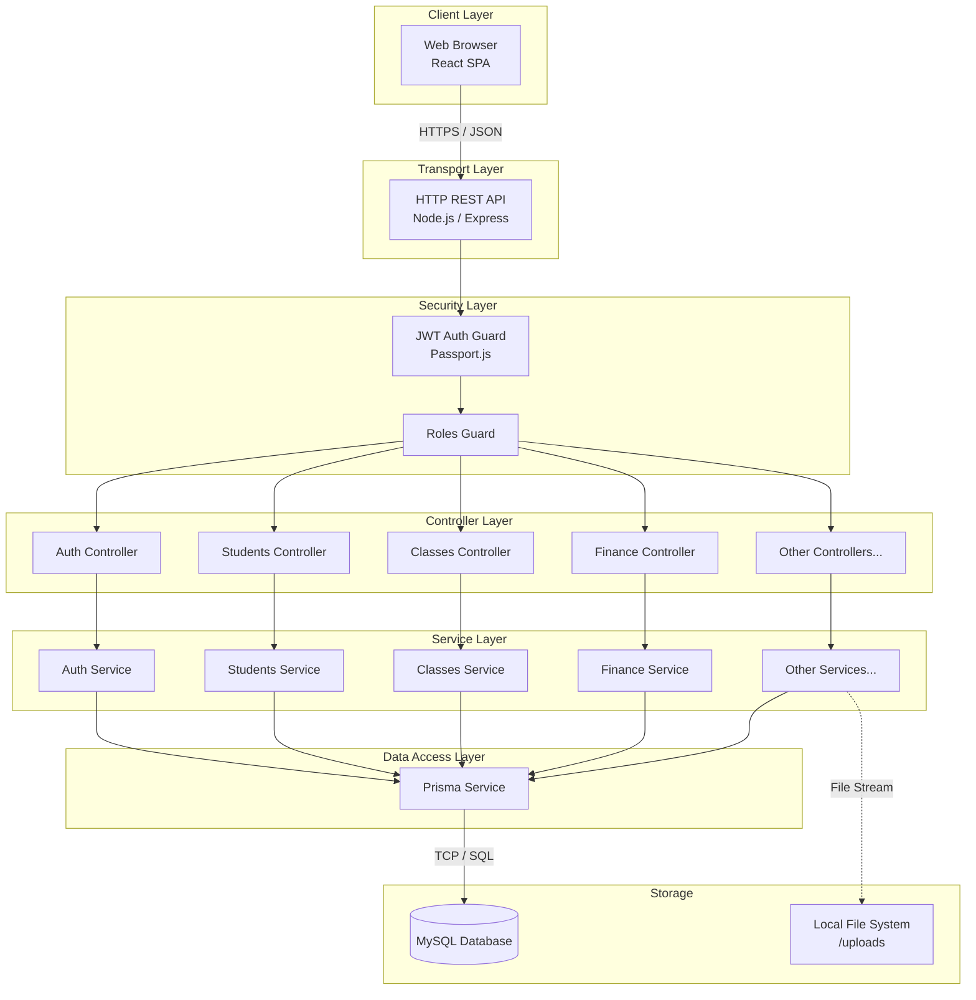
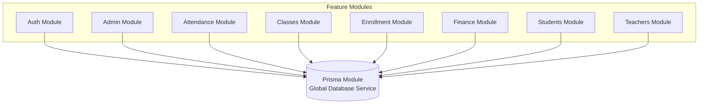

# Alphabet-SMIS: Architecture and System Design

## 1. Architectural Pattern

Alphabet-SMIS employs a **Modular, Layered Monolithic Architecture** driven by the NestJS framework on the backend, paired with a **Component-Based Single Page Application (SPA)** on the frontend.

**Why this pattern was chosen:**
- **Layered approach:** Separating HTTP transport (Controllers), business logic (Services), and data access (Prisma Repositories) ensures that the system is testable and maintainable. If the school decides to expose a GraphQL endpoint or a gRPC service in the future, the business logic in the Services remains completely untouched.
- **Modular Monolith over Microservices:** While microservices offer extreme scalability, they introduce immense operational complexity (distributed tracing, network latency, eventual consistency). For a school management system where immediate consistency is often required (e.g., payment verification -> student enrollment status) and the user base is relatively predictable, a modular monolith offers the best balance of maintainability, speed of development, and deployment simplicity.

---

## 2. System Architecture Diagram

---

## 3. Request Lifecycle Walkthrough

To understand how data flows through the system, let's trace a typical request: **A Teacher inputs a new grade for a Student.**

1. **Client Action (React):** The Teacher fills out a grade form on the UI and clicks "Submit". The browser's `fetch` API constructs an HTTP POST request containing the JSON payload and attaches the Teacher's JWT access token in the `Authorization: Bearer <token>` header.
2. **Transport & Routing (NestJS):** The request hits the Node.js server. NestJS routes the `/students/:id/results` POST request to the corresponding method in the `StudentsController`.
3. **Authentication Guard:** Before the controller logic runs, the `JwtAuthGuard` intercepts the request. It decodes the JWT using the secret key. If the token is invalid or expired, it returns a `401 Unauthorized`.
4. **Authorization Guard:** The `RolesGuard` checks the decoded token payload to ensure the user has the `TEACHER` or `ADMIN` role. If not, it returns a `403 Forbidden`.
5. **Validation Pipe:** The incoming JSON body is intercepted by NestJS's `ValidationPipe` (using `class-validator`). It ensures the payload matches the expected DTO (Data Transfer Object)—e.g., ensuring `score` is a number and `subjectKey` is a string.
6. **Controller Execution:** The `StudentsController` receives the validated payload and passes it directly to the `StudentsService`.
7. **Business Logic (Service Layer):** The `StudentsService` executes the business rules. It might first query the database to ensure the student exists and is enrolled in the teacher's class. It then formats the data for insertion.
8. **Data Access (Prisma):** The `StudentsService` calls `this.prisma.result.upsert(...)` on the injected `PrismaService`.
9. **Database Execution:** Prisma translates the JavaScript call into a secure, parameterized SQL query and sends it over TCP to the MySQL server.
10. **Response:** MySQL confirms the insertion. The `PrismaService` returns the newly created record. The `StudentsService` returns this to the `StudentsController`, which finally responds to the Client with an HTTP `201 Created` and the JSON representation of the new grade.

---

## 4. Module and Service Breakdown

The backend is strictly divided into feature modules.

| Module | Core Responsibility | Key Inputs / Outputs | Dependencies |
| :--- | :--- | :--- | :--- |
| **AuthModule** | Handles login, token generation, and password resets. | **In:** Credentials. **Out:** JWTs. | `PrismaModule`, `PassportModule`, `JwtModule` |
| **AdminModule** | Manages administrator profiles and system-wide settings. | **In:** Admin configs. **Out:** Updated settings. | `PrismaModule` |
| **AttendanceModule** | Tracks daily presence/absence records for students. | **In:** Student ID, Date, Status. **Out:** Attendance records. | `PrismaModule` |
| **ClassesModule** | Manages class definitions, capacities, subjects, and timetables. | **In:** Class metadata. **Out:** Class rosters, timetables. | `PrismaModule` |
| **EnrollmentModule** | Processes new student applications. | **In:** Application forms. **Out:** Application status, newly generated Students. | `PrismaModule` |
| **FeedsModule** | Manages the school announcement board. | **In:** Text, Images. **Out:** Feed arrays. | `PrismaModule` |
| **FinanceModule** | Tracks fee structures, student payments, and school expenses. | **In:** Payment records, amounts. **Out:** Payment receipts, ledgers. | `PrismaModule` |
| **GalleryModule** | Manages the public photo gallery. | **In:** Images, metadata. **Out:** Image URLs. | `PrismaModule` |
| **HostelsModule** | Manages boarding facilities and assigns students to rooms. | **In:** Capacity, Student IDs. **Out:** Hostel rosters. | `PrismaModule` |
| **StudentsModule** | Core module for managing student data, results, and history. | **In:** Demographics, Grades. **Out:** Report cards, Student profiles. | `PrismaModule` |
| **SubjectsModule** | Manages the catalog of available subjects. | **In:** Subject codes, names. **Out:** Subject lists. | `PrismaModule` |
| **TeachersModule** | Manages teacher profiles and class assignments. | **In:** Qualifications, class links. **Out:** Teacher schedules. | `PrismaModule` |
| **PrismaModule** | **Global** module that instantiates the database client. | **In:** Prisma queries. **Out:** Database rows. | *None* |

### Component Dependency Graph

---

## 5. Infrastructure and Deployment Layout

While the system can be deployed in various ways, the architecture assumes standard Node.js server deployment patterns:

- **Frontend:** Built via `vite build` into static HTML/CSS/JS files. Can be served via Nginx, Apache, or edge CDNs like Vercel/Netlify.
- **Backend API:** Runs as a persistent Node.js process using `pm2` or inside a Docker container. Exposed on a specific port (e.g., 3000) and usually placed behind a reverse proxy (Nginx) for SSL termination.
- **Database:** A standard MySQL 8.0+ server. Can be hosted locally on the same VM as the backend, or on a managed cloud database (e.g., AWS RDS, DigitalOcean Managed Databases).
- **File Storage:** Uploaded files (gallery images, feed images) are currently stored on the local file system in the `/uploads` directory and served statically via `@nestjs/serve-static`.

---

## 6. Scalability Considerations

**What can be scaled horizontally?**
- **The Frontend:** As static files, the React app scales infinitely via CDN distribution.
- **The Backend API:** The NestJS API is stateless (auth is handled via JWT, not in-memory sessions). Therefore, you can spin up multiple instances of the backend behind a load balancer without issue.

**What cannot be scaled horizontally (easily)?**
- **File Storage:** Because image uploads are saved directly to the local `/uploads` directory on the server disk, running multiple backend servers would result in fragmented file storage (Image A on Server 1, Image B on Server 2). 
  - *Mitigation strategy:* To scale the backend horizontally, the file upload mechanism must be refactored to use object storage like AWS S3 or Cloudinary.
- **The Database:** The MySQL database is a single node. It scales vertically (adding more CPU/RAM).

---

## 7. Background Jobs and Workers

Currently, Alphabet-SMIS relies purely on **synchronous HTTP request-response cycles**. There are no background queue workers (like Bull/Redis) or cron jobs configured in the NestJS application context. 

Tasks that traditionally might be background jobs (such as calculating class aggregates) are calculated either on-the-fly via Prisma queries during the request, or handled client-side. If the school grows significantly, introducing `@nestjs/schedule` for night-time report generation or automated fee reminder emails would be the next architectural step.
