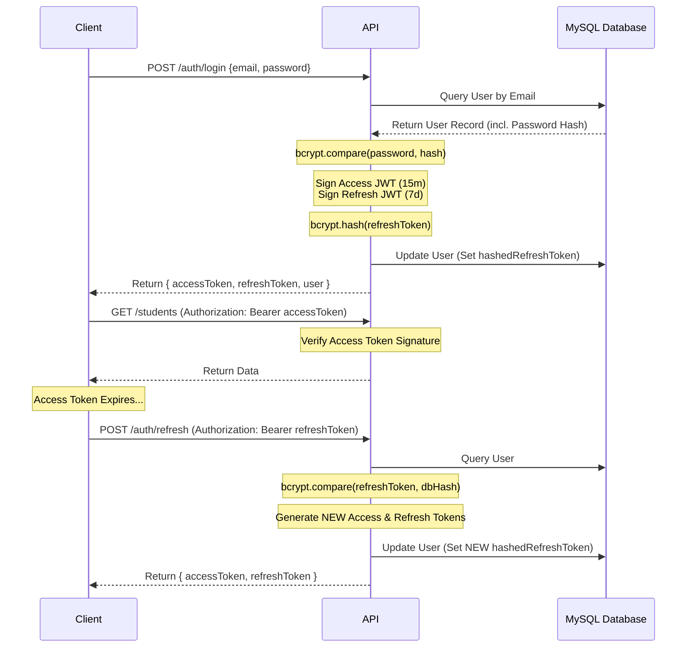

# Alphabet-SMIS: Security Implementation

## 1. Authentication Mechanism

Alphabet-SMIS uses a secure, stateless **JWT (JSON Web Token)** authentication mechanism featuring a dual-token architecture: short-lived Access Tokens and long-lived Refresh Tokens.

### End-to-End Flow

1. **Login:** The user submits their email and password.
2. **Verification:** The `AuthService` retrieves the user by email and compares the hashed password in the DB using `bcrypt`.
3. **Token Generation:** If valid, the server signs two tokens:
   - **Access Token:** Expires in 15 minutes. Contains the user's ID (`sub`), `email`, and `role`.
   - **Refresh Token:** Expires in 7 days.
4. **Token Storage:** The server hashes the Refresh Token using `bcrypt` and stores the hash in the user's database record (`hashedRefreshToken`). It then returns both raw tokens to the client.
5. **Authenticated Requests:** The client attaches the Access Token to the `Authorization: Bearer <token>` header of subsequent API requests.
6. **Token Expiry & Refresh:** When the Access Token expires, the client calls `/auth/refresh` with the Refresh Token. The server verifies the token against the hash in the DB. If it matches, new tokens are issued, and the DB hash is updated (Refresh Token Rotation).
7. **Logout:** The client calls `/auth/logout`, and the server nullifies the `hashedRefreshToken` in the database, invalidating the refresh chain.

### Authentication Flow Diagram

---

## 2. Authorization Model

Authorization is enforced via Role-Based Access Control (RBAC). The system uses a Prisma `enum Role`: `ADMIN`, `TEACHER`, `STUDENT`, `HOSTEL_OWNER`.

### Enforcement Mechanisms
- **`AuthGuard('jwt')`:** A Passport strategy that decodes the token and attaches the user payload to the `Request` object.
- **Roles Decorator & Guard:** Custom decorators (`@Roles()`) and guards (`RolesGuard`) inspect `req.user.role` to verify permission before the controller method executes.

### Role Permissions Map

| Role | Access Level | Description |
| :--- | :--- | :--- |
| **`ADMIN`** | **God Mode** | Can create/edit users, manage global settings, delete classes, view all finances, and manage enrollments. |
| **`TEACHER`** | **Scoped Write** | Can view only their assigned classes. Can input grades and attendance for their students. Cannot view global finances or manage other teachers. |
| **`STUDENT`** | **Read-Only (Self)** | Can view their own report cards, timetable, and attendance history. Cannot modify any records. |
| **`HOSTEL_OWNER`** | **Scoped Write** | Can view and manage capacity and student assignments strictly within their owned hostels. |

---

## 3. Input Validation and Sanitization

- **Library Used:** The API utilizes `class-validator` and `class-transformer` paired with NestJS's global `ValidationPipe`.
- **How it works:** Every controller endpoint defines a Data Transfer Object (DTO) class. The `ValidationPipe` intercepts incoming JSON payloads, strips out any properties not explicitly defined in the DTO (`whitelist: true`), and validates types (e.g., `@IsEmail()`, `@IsNumber()`, `@MaxLength(50)`).
- **Attack Vectors Mitigated:**
  - **NoSQL / SQL Injection:** Prisma automatically parameterizes all queries, neutralizing SQL injection.
  - **Mass Assignment:** Whitelisting prevents attackers from injecting fields they shouldn't control (e.g., passing `{"role": "ADMIN"}` during a profile update).

---

## 4. Data Protection

- **Encryption at Rest (Database):** 
  - **Passwords:** Never stored in plaintext. Hashed using `bcrypt` with a salt round of 10.
  - **Refresh Tokens:** Hashed via `bcrypt` to prevent compromised databases from yielding usable, long-lived tokens.
- **Encryption in Transit:** The application is intended to run behind a reverse proxy (e.g., Nginx) configured with TLS/SSL certificates (HTTPS), ensuring all payloads and tokens are encrypted over the network.
- **Sensitive Field Handling:** The `AuthService` expressly omits the `passwordHash` and `hashedRefreshToken` when returning User objects to the client.
- **Secret Management:** Sensitive keys (`DATABASE_URL`, `JWT_SECRET`, `JWT_REFRESH_SECRET`) are strictly managed via environment variables (`.env`) and are excluded from version control (`.gitignore`).

---

## 5. API Security and Edge Protections

- **CORS (Cross-Origin Resource Sharing):** Enabled via `app.enableCors()` in `main.ts`. In production, this should be restricted to the specific origin of the deployed React frontend to prevent unauthorized domains from making browser-based requests.
- **Forgot Password Flow:** The `/auth/forgot-password` endpoint intentionally always returns "If that email is registered, a reset link has been sent" regardless of whether the email exists in the database. This prevents **User Enumeration Attacks**.

### Known Security Considerations (Areas for Hardening)

1. **Rate Limiting:** Currently, the API lacks a rate limiter. The `@nestjs/throttler` package should be implemented to prevent brute-force attacks on the `/auth/login` endpoint.
2. **Helmet Security Headers:** The `helmet` package is not yet applied. It should be added to automatically set secure HTTP headers (e.g., X-Frame-Options, Content-Security-Policy).
3. **Token Blacklisting:** While Refresh Token rotation is implemented, there is no in-memory mechanism (like Redis) to immediately blacklist a compromised *Access Token* before its 15-minute expiry.
4. **File Upload Verification:** If users upload profile pictures or gallery images, strict MIME-type validation and file size limits must be enforced to prevent the upload of malicious executables to the `/uploads` directory.
