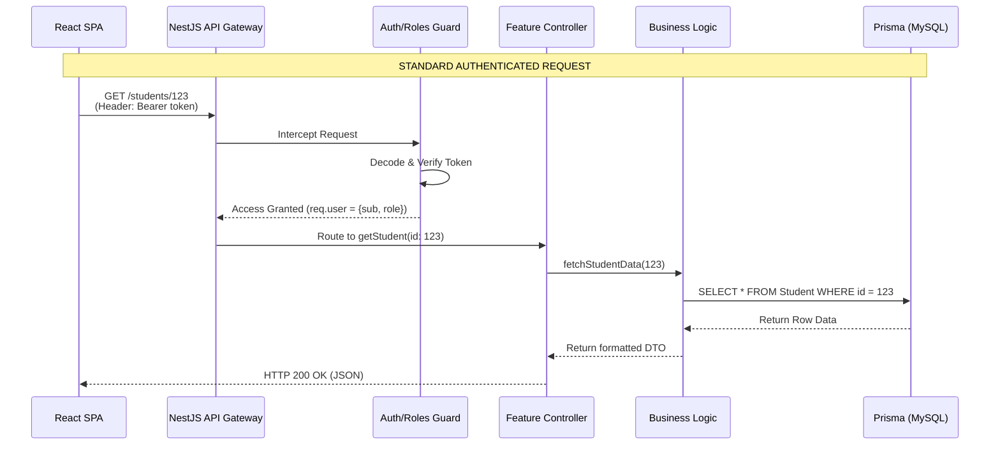

# Alphabet-SMIS: Complete API Specification

## 1. Global Conventions

- **Base URL:** `/` (Locally: `http://localhost:3000`)
- **Content-Type:** `application/json` (except for endpoints accepting `multipart/form-data` for file uploads).
- **Authentication:** Bearer token authorization is required for all protected routes.
  - **Header Format:** `Authorization: Bearer <JWT_ACCESS_TOKEN>`
- **Pagination:** Where applicable, lists use query parameters `?page=1&limit=10`.
- **Date Formats:** ISO-8601 strings (e.g., `2026-05-19T00:00:00.000Z`) for timestamps (`createdAt`, `updatedAt`). Date-only fields (`dob`) use `YYYY-MM-DD`.

### Standard Error Response Shape
```json
{
  "statusCode": 400,
  "message": ["email must be an email", "password should not be empty"],
  "error": "Bad Request"
}
```

### Global Error Reference Table
| HTTP Status | Meaning | Typical Trigger |
| :--- | :--- | :--- |
| **400 Bad Request** | Validation Error | Missing fields, wrong types in payload (`class-validator` failures). |
| **401 Unauthorized** | Missing/Invalid Token | No `Authorization` header, or the JWT is expired/tampered with. |
| **403 Forbidden** | Insufficient Permissions | A `STUDENT` tries to access a `TEACHER` endpoint (`RolesGuard`). |
| **404 Not Found** | Resource Missing | Requesting an ID that doesn't exist in the database. |
| **409 Conflict** | Duplicate Entry | Prisma `P2002` constraint error (e.g., registering an existing email). |
| **500 Internal Server Error** | Server Crash | Unhandled exceptions or database connection failures. |

---

## 2. API Communication Flow



---

## 3. Endpoint Reference

### A. Authentication & User Management (`/auth`)

#### `POST /auth/login`
- **Description:** Authenticates a user and issues tokens.
- **Auth Required:** No
- **Request Body:**
  ```json
  {
    "email": "admin@school.com",
    "password": "securepassword123"
  }
  ```
- **Response (200 OK):**
  ```json
  {
    "user": { "id": 1, "email": "admin@school.com", "role": "ADMIN" },
    "accessToken": "eyJhb...",
    "refreshToken": "eyJhb..."
  }
  ```
- **Side Effects:** Hashes and stores the new refresh token in the `User` table.

#### `POST /auth/register`
- **Description:** Creates a new user profile.
- **Auth Required:** No (Usually locked down to Admin in production, but currently open).
- **Request Body:**
  ```json
  {
    "email": "teacher@school.com",
    "password": "securepassword123",
    "role": "TEACHER"
  }
  ```
- **Response (201 Created):** `{ "accessToken": "...", "refreshToken": "..." }`
- **Side Effects:** Creates a row in `User`.

#### `POST /auth/refresh`
- **Description:** Trades a valid refresh token for new access/refresh tokens.
- **Auth Required:** Yes (Custom `jwt-refresh` strategy). Header must contain the Refresh Token.
- **Response (200 OK):** `{ "accessToken": "...", "refreshToken": "..." }`
- **Side Effects:** Updates the `hashedRefreshToken` in the database.

#### `POST /auth/logout`
- **Description:** Invalidates the current user's refresh token.
- **Auth Required:** Yes (Any role).
- **Response (200 OK):** `{}`
- **Side Effects:** Sets `hashedRefreshToken` to `null` for the user.

---

### B. Students Domain (`/students`)

#### `GET /students`
- **Description:** Fetches a list of all enrolled students.
- **Auth Required:** Yes (`ADMIN`, `TEACHER`)
- **Query Params:** `?classId=5` (Optional filter)
- **Response (200 OK):**
  ```json
  [
    {
      "id": 1,
      "student_id": "STU001",
      "firstName": "John",
      "lastName": "Doe",
      "class": { "name": "Grade 10A" }
    }
  ]
  ```

#### `POST /students`
- **Description:** Manually creates a new student record.
- **Auth Required:** Yes (`ADMIN`)
- **Request Body:**
  ```json
  {
    "firstName": "Jane",
    "lastName": "Smith",
    "email": "jane@example.com",
    "classId": 2,
    "guardianName": "Bob Smith"
  }
  ```
- **Response (201 Created):** Returns the newly created Student object.
- **Side Effects:** Creates a row in `Student`. Generates a unique `student_id`.

#### `GET /students/:id`
- **Description:** Fetches complete details for a single student.
- **Auth Required:** Yes (`ADMIN`, `TEACHER`, or `STUDENT` if requesting self).
- **Path Param:** `id` (numeric ID of the student).

#### `PATCH /students/:id`
- **Description:** Updates specific fields of a student record.
- **Auth Required:** Yes (`ADMIN`)
- **Request Body:** `{ "hostelId": 4, "scholarType": "Boarding" }`
- **Response (200 OK):** Updated Student object.
- **Side Effects:** Updates `Student` table row.

---

### C. Classes & Timetables (`/classes`)

#### `GET /classes`
- **Description:** Returns all classes.
- **Auth Required:** Yes (Any role)
- **Response (200 OK):** Array of Class objects, including `capacity` and `subjects` JSON.

#### `POST /classes`
- **Description:** Creates a new class structure.
- **Auth Required:** Yes (`ADMIN`)
- **Request Body:**
  ```json
  {
    "name": "Form 1 Alpha",
    "level": "Junior",
    "capacity": 40,
    "subjects": ["math", "eng", "sci"]
  }
  ```

#### `PATCH /classes/:id/timetable`
- **Description:** Updates the class schedule matrix.
- **Auth Required:** Yes (`ADMIN`)
- **Request Body:** `{ "timetable": { "Monday": [{ "time": "08:00", "subject": "math" }] } }`

---

### D. Teachers & Grading (`/teachers`)

#### `GET /teachers/me/main-class`
- **Description:** Fetches the class where the authenticated teacher is the Class Teacher.
- **Auth Required:** Yes (`TEACHER`)
- **Response (200 OK):** Class object with embedded Students array.

#### `POST /teachers/grades/entries/bulk`
- **Description:** Submits continuous assessment or exam scores for multiple students at once.
- **Auth Required:** Yes (`TEACHER`)
- **Request Body:**
  ```json
  {
    "subjectKey": "math",
    "term": 1,
    "academicYear": "2026/2027",
    "grades": [
      { "studentId": 1, "score": 85 },
      { "studentId": 2, "score": 92 }
    ]
  }
  ```
- **Response (201 Created):** `{ "success": true, "count": 2 }`
- **Side Effects:** Uses Prisma `upsert` to create or update `Result` table records for the specified term.

---

### E. Finance & Payments (`/finance`)

#### `GET /finance/overview`
- **Description:** Gets aggregated financial stats (Total Revenue, Total Expenses).
- **Auth Required:** Yes (`ADMIN`)
- **Response (200 OK):**
  ```json
  {
    "totalRevenue": 45000.00,
    "totalExpenses": 12000.00,
    "netIncome": 33000.00
  }
  ```

#### `POST /finance/payments`
- **Description:** Records a new fee payment.
- **Auth Required:** Yes (`ADMIN`)
- **Request Body:**
  ```json
  {
    "studentId": 15,
    "amount": 500,
    "method": "Bank Transfer",
    "reference": "TXN-98765",
    "academicYear": "2026",
    "term": 1
  }
  ```
- **Side Effects:** Inserts a row into `Payment`. Fails with `409 Conflict` if the `reference` already exists.

---

### F. Enrollment Applications (`/enrollment`)

#### `POST /enrollment/apply`
- **Description:** Submits a public application for a prospective student.
- **Auth Required:** No (Public Endpoint)
- **Request Body:** Contains applicant and guardian details (name, dob, previousSchool, phone, email).
- **Response (201 Created):** `{ "message": "Application submitted successfully", "applicationId": 102 }`
- **Side Effects:** Inserts into `Application` with status `PENDING`.

#### `PATCH /enrollment/applications/:id/status`
- **Description:** Approves or Rejects an application.
- **Auth Required:** Yes (`ADMIN`)
- **Request Body:** `{ "status": "APPROVED" }`
- **Side Effects:** If approved, a corresponding `Student` record and `User` login may be dynamically generated depending on service logic.

---

### G. Public Results Portal (`/public-results`)

#### `POST /public-results/check`
- **Description:** Allows parents/students to check final grades without logging in, using a secure pin/ID combination.
- **Auth Required:** No (Public)
- **Request Body:**
  ```json
  {
    "student_id": "STU001",
    "term": 1,
    "academicYear": "2026"
  }
  ```
- **Response (200 OK):** Returns the aggregated array of `Result` objects for that specific term, stripped of internal database IDs.
